# Lebanon Hockey project architecture and information flow

Code snapshot: 19 November 2026. This guide covers the current working tree, including changes that have not been committed.

Lebanon Hockey combines the federation website, online store, donations, membership applications, team profiles, game sheets, visitor chat, and administration in **one Node.js application**. Express serves both the pages and the API. All domains share one SQLite database; Stripe handles card payments, SMTP handles email, and the local filesystem holds images and invoice PDFs.

Start with the [visual architecture map](docs/architecture-overview.svg), also available as a [PNG](docs/architecture-overview.png). The [complete SQL schema](docs/database-schema.sql) contains every column, default, constraint, foreign key, and explicit index after startup migrations: **33 application tables and 41 explicit indexes**. SQLite also creates indexes for primary and unique constraints.

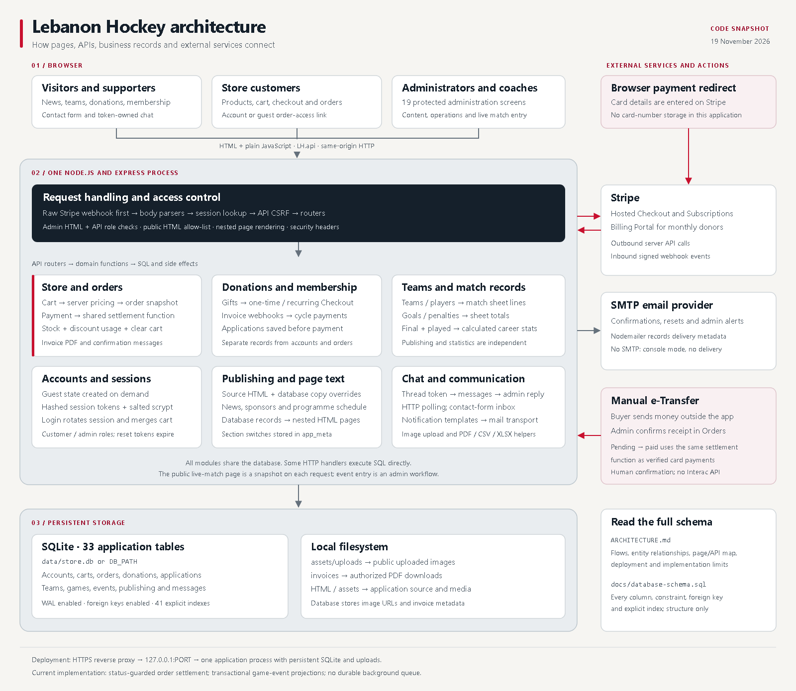

## Contents

1. [System architecture](#system-architecture)
2. [Project structure and code ownership](#project-structure-and-code-ownership)
3. [Startup and request handling](#startup-and-request-handling)
4. [Browser state and authentication](#browser-state-and-authentication)
5. [Database schema and relationships](#database-schema-and-relationships)
6. [Store and order information flow](#store-and-order-information-flow)
7. [Donation information flow](#donation-information-flow)
8. [Membership information flow](#membership-information-flow)
9. [Teams games and player statistics](#teams-games-and-player-statistics)
10. [Page content and publishing](#page-content-and-publishing)
11. [Chat contact email and uploads](#chat-contact-email-and-uploads)
12. [Pages and API map](#pages-and-api-map)
13. [Deployment and persistence](#deployment-and-persistence)
14. [Current implementation limits](#current-implementation-limits)
15. [Where to make changes](#where-to-make-changes)

## System architecture

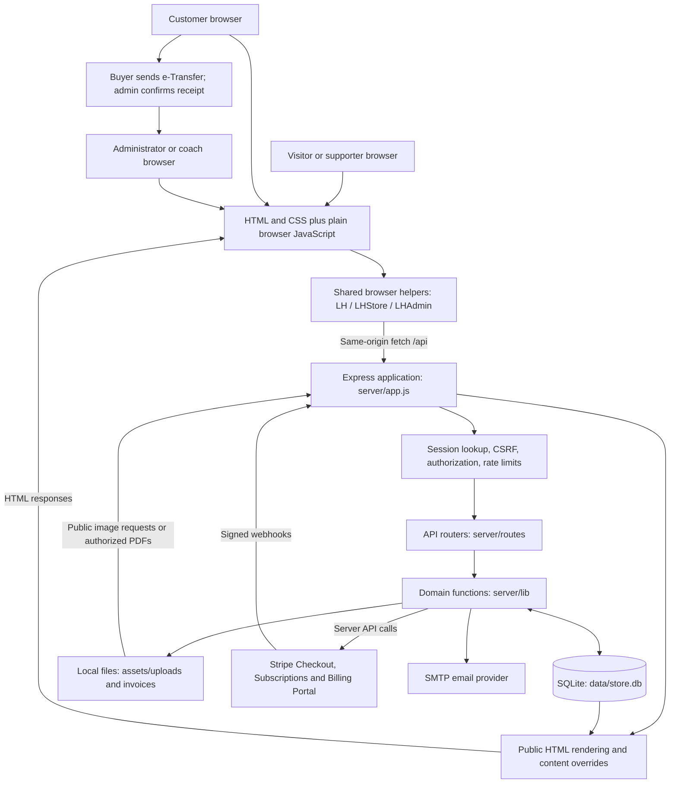

The code is a modular monolith: routers and domain helpers provide internal separation, but they run together in one process and use the same database connection. Some routes execute SQL directly, so the boundary between HTTP handlers and domain services is a convention rather than a strictly enforced layer.

There is no frontend framework, bundler, ORM, separate API server, worker service, or message broker. Browser scripts use ordinary DOM operations and `fetch`. Nested article, team, player, and game pages render on the server so their content and sharing metadata are present in the initial HTML.

Runtime requirements and direct dependencies come from [package.json](package.json): Node **22.5 or newer**, Express 5, Stripe, Nodemailer, and PDFKit. SQLite is Node's built-in `node:sqlite` module.

## Project structure and code ownership

| Location | Responsibility |
| --- | --- |
| Root `*.html` | 22 public page files: informational pages, store, accounts, policies, membership, donations |
| `admin/*.html` | 19 administration screens, served through server authorization |
| [assets/api.js](assets/api.js) | Shared `window.LH` API client, session cache, CSRF, formatting, notifications |
| [assets/app.js](assets/app.js) | Shared navigation and account/cart indicators |
| [assets/store-core.js](assets/store-core.js) | Shared `LHStore` helpers, discount selection, order summaries and payment notices |
| [assets/admin-core.js](assets/admin-core.js) | Shared `LHAdmin` helpers, modal UI, admin identity and logout |
| `assets/*.js` | Public page controllers such as `shop.js`, `membership.js`, and `chat.js` |
| `assets/admin/*.js` | One controller per admin screen; `dashboard.js` controls the admin index |
| `assets/*.css` | Shared design tokens and components, store styles, admin styles |
| `assets/photos`, `assets/fonts` | Repository-owned photography and locally hosted fonts |
| `assets/uploads` | Runtime image uploads, referenced by URL from database records |
| [server/index.js](server/index.js) | Startup data initialization, timers, HTTP listener, graceful shutdown |
| [server/app.js](server/app.js) | Middleware order, router mounting, public/admin file serving and errors |
| [server/config.js](server/config.js) | Environment configuration and feature availability |
| [server/db.js](server/db.js) | Database connection, schema, additive migrations and core seeds |
| [server/middleware/auth.js](server/middleware/auth.js) | Sessions, CSRF, authentication, admin authorization and IP limits |
| `server/routes` | HTTP handlers for each domain |
| `server/lib` | Pricing, orders, payments, publishing, statistics, emails, uploads and exports |
| `scripts` | HTML generators, admin creation, smoke checks and site/contrast checks |
| `data/store.db` | Default runtime database; `DB_PATH` can select another path |
| `invoices` | Generated PDF documents; database stores invoice metadata |

Of the 41 HTML files, **32 are generated**: 13 public pages from [build-store-pages.mjs](scripts/build-store-pages.mjs), plus all 19 admin pages from [build-admin-pages.mjs](scripts/build-admin-pages.mjs). The nine public pages maintained directly are `index`, `about`, `contact`, `donation`, `events`, `membership`, `news`, `sponsors`, and `teams`.

`npm run build` regenerates HTML. It does not compile the server or bundle browser JavaScript. [scripts/update-pages.mjs](scripts/update-pages.mjs) is a historical migration rather than the normal build entrypoint.

## Startup and request handling

### Startup sequence

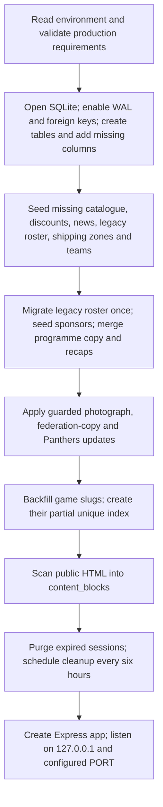

Schema initialization happens when `db.js` is imported. Missing columns are added through `PRAGMA table_info` checks followed by `ALTER TABLE`; there is no separate versioned migration runner. Several one-time data updates use `app_meta` markers. Initial seed values are application defaults and source content, not a statement about the current contents of a deployed database.

### Incoming request order

Order matters in [server/app.js](server/app.js):

1. Set security headers and optional proxy trust.
2. Handle `/api/stripe/webhook` using the **raw request body** and Stripe signature verification.
3. Parse JSON or form bodies, capped at 256 KB, and look up an existing session.
4. Apply CSRF checks to API mutations, then dispatch public and admin API routers.
5. Return a JSON 404 for an unknown API endpoint.
6. Authorize `/admin` before serving admin HTML.
7. Serve `/assets` from the public asset directory.
8. Serve root public `.html` files with content overrides and visibility flags applied.
9. Handle nested news, team, player and game pages.
10. Return final 404 or error responses.

The webhook is mounted before JSON parsing because signature verification requires the exact incoming bytes. It does not use session or CSRF authentication. Uploads use a separate binary parser on their admin route.

## Browser state and authentication

### What lives where

| Information | Authority and storage |
| --- | --- |
| Account identity, password hash and role | `users` in SQLite |
| Login or guest session | Raw opaque token in `lh_sid` HttpOnly cookie; SHA-256 token hash in `sessions` |
| CSRF token | `sessions.csrf_token`; cached in browser JavaScript after issuance |
| Cart items and quantities | `carts` and `cart_items` in SQLite |
| Selected discount code | Browser `sessionStorage`, key `lh_discount`; server validates the code each time |
| Visitor conversation access | Raw bearer token in `localStorage`, key `lh_chat_token`; hash in `chat_threads` |
| Unsent live event creations | Browser `localStorage`, key `lh.live.<gameId>.queue`, until acknowledged |
| Guest order access | Bearer `orders.access_token`, stored as a raw token in SQLite and carried in confirmation/email links |
| Monthly donation management | Raw bearer link in donor email; only token hash in `donations` |

Chat and guest-order tokens are independent of login. Membership registration and donating do not automatically create user accounts.

### A normal API write

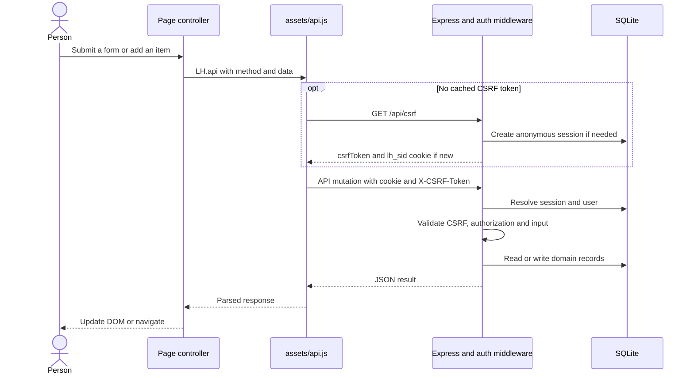

`GET /api/session` reads state without creating a session. `api.js` caches its response for a page load and acquires CSRF lazily. A write rejected with 403 gets one session/CSRF refresh and retry. Some GET handlers perform limited writes, including checkout reconciliation, chat read markers, and cart-summary initialization; HTTP GET is not universally side-effect-free in this code.

Session tokens contain 32 random bytes. Sessions last 30 days and the cookie uses `HttpOnly`, `SameSite=Lax`, and `Secure` in production. Login and registration rotate the token and merge any guest cart into the account cart. Passwords use salted scrypt. Password resets use hashed, one-hour, single-use tokens and revoke existing sessions.

`requireAuth` protects account operations. `requireAdmin` checks `users.role` on **both admin HTML and admin APIs**, returning 404 for unauthorized access. Demoting an admin revokes their sessions, and the last admin cannot be demoted. Rate limits are in memory, keyed by client IP, on selected public forms and authentication routes.

Sources: [auth middleware](server/middleware/auth.js), [auth routes](server/routes/auth.js), [password hashing](server/lib/password.js), [cart ownership and merge](server/lib/cart.js).

## Database schema and relationships

### Storage conventions

- Monetary amounts use integer cents. The default currency is lowercase `cad`; API responses generally use camelCase field names.
- Boolean flags use SQLite integers and are usually serialized as JavaScript booleans.
- Most record timestamps use SQLite UTC text from `datetime('now')`. Schedule dates and match dates/clock fields have their own domain formats; do not treat every text date as a UTC instant.
- Most tables use integer IDs. `content_blocks` and `app_meta` use text keys; country-to-zone mappings use a composite key.
- URLs point to uploaded or repository-owned files; image bytes and invoice PDF bytes are not stored in database columns.

The [SQL snapshot](docs/database-schema.sql) is the exact field-level reference. The following inventory explains what every table means.

### Accounts and commerce

| Table | Stored information and main relationships |
| --- | --- |
| `users` | Unique email, password hash, names, phone, customer/admin role |
| `sessions` | Unique token hash, CSRF token, expiry; optional `user_id` with cascade deletion |
| `password_resets` | User, unique token hash, expiry and use time; deleted with the user |
| `categories` | Catalogue category name, unique slug and display order |
| `products` | Product identity, price, category, image, stock and visibility; category deletion sets the link null |
| `product_variants` | Product-specific size/option, price delta and stock; deleted with the product |
| `carts` | Optional account owner or guest session hash; user deletion deletes their carts |
| `cart_items` | Cart, product, optional variant, quantity; cart/product deletion cascades |
| `discounts` | Unique code, percent/fixed value, date and subtotal conditions, redemption cap/count |
| `orders` | Order number, optional user/cart, email, status, immutable-at-checkout totals/address snapshots, payment method, provider IDs and guest token |
| `order_items` | Order line names, variant label, price and quantity snapshots; optional links to current catalogue records |
| `invoices` | One optional invoice per order, unique invoice number and issue time; PDF is on disk |
| `shipping_zones` | Flat/per-item charges, free-over threshold, delivery estimate, default and active flags |
| `shipping_zone_countries` | Composite `(zone_id, country_code)` mapping; deleted with the zone |

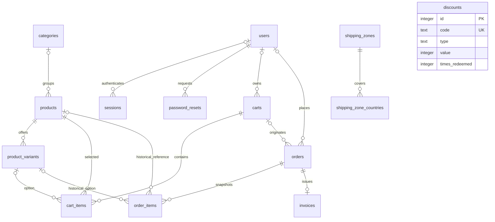

In these diagrams, `o|` means an optional parent and `o{` means zero or more child rows. Lines show declared foreign keys. `discounts.code → orders.discount_code` and `sessions.token_hash → carts.session_hash` are **application-level associations**, without foreign key constraints. `email_log.order_id` is also a logical reference rather than a foreign key.

Deleting a product or variant sets its historical order-item reference to null while preserving the line snapshots. User/cart deletion can clear an order's ownership/origin link while keeping the order. Catalogue admin deletion additionally checks order references and may deactivate a referenced product instead of deleting it.

### Donations membership and hockey

| Table | Stored information and main relationships |
| --- | --- |
| `donations` | One-time/monthly gift, contact/message, amount and status, Stripe identifiers, management-token hash and public-display consent |
| `donation_payments` | Monthly invoice payment/failure records; donation FK and unique Stripe invoice ID |
| `registrations` | Membership tier/fee/payment state, contact and player eligibility details; independent of user accounts |
| `roster_players` | Legacy men's/women's roster model with programme, squad, position, number and locations |
| `teams` | Public programme/team profile, slug, description, photo/gallery, staff, honours and visibility |
| `players` | Team profile, unique slug, position/number/bio/photo, visibility and prior-history counters; team deletion cascades |
| `games` | Fixture/header, optional own/opponent team links, date/venue/score, status, public slug, publish flag and event mode |
| `game_sheet_players` | Per-match identity overrides, side, lineup details, played flag and per-match statistics; optional player and registration links |
| `game_events` | Goal/penalty, side/period/time, scorer/assists or penalized sheet line, retry ID and event details |
| `game_goalies` | Goalkeeper period records: side, period, optional sheet line, minutes, saves and goals against |

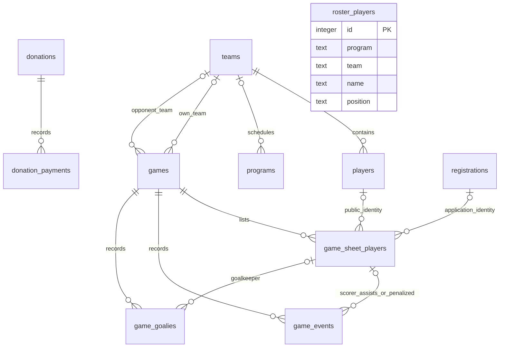

The event-to-sheet line above represents four separate optional FKs: scorer, first assist, second assist, and penalized player. Deleting a game cascades to its sheet, events and goalkeeper records. Deleting a linked profile or registration preserves the sheet row and its stored overrides/statistics by setting the link null. Blank fields resolved from the linked record are not immutable identity snapshots. Sheet rows have a unique `(game_id, player_id)` constraint; null player IDs allow manually entered people.

`roster_players` and `players` are separate models. Startup migrates legacy roster entries to public profiles **once** using an `app_meta` marker; subsequent legacy roster edits do not continually synchronize to `players`.

### Publishing communications and settings

| Table | Stored information and main relationships |
| --- | --- |
| `news_posts` | Article slug, title, excerpt/body, image/author/contact/share metadata, publication time and active flag |
| `sponsors` | Partner name/tier, text, website/logo, active flag and order |
| `programs` | Schedule item, optional team, kind/date/location/description and registration/link details |
| `content_blocks` | Source-page text key, original text, admin override, orphan state and update time |
| `app_meta` | Section switches, cached Stripe donation-product ID and one-time migration markers |
| `contact_messages` | Contact sender identity/email, message and creation time |
| `chat_threads` | Hashed visitor token, optional contact details, thread status and activity/notification times |
| `chat_messages` | Thread FK, visitor/admin sender, body and read/creation times |
| `email_log` | Recipient, subject, message kind, optional logical order ID, delivery/log/failure state and error |

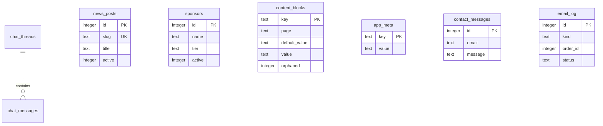

`programs` appears in the hockey diagram because of its team FK. The other standalone entities have no declared relational links; their association to pages, external services, or orders is handled in code.

## Store and order information flow

### Pricing and the order snapshot

1. The product page submits product/variant IDs and a quantity. Cart mutations are owned by the active account or guest session.
2. `getCartDetail` joins cart lines to current product and variant records, filters inactive products, calculates unit prices and checks availability.
3. The server validates the discount, resolves shipping from destination country, then calculates totals.
4. Checkout copies names, variant labels, prices, quantities, customer contact and shipping/totals into `orders` and `order_items`.
5. Later product edits do not rewrite those historical order snapshots.

```text
unit price = product.price_cents + variant.price_delta_cents
subtotal = sum(unit price × quantity)
discounted subtotal = subtotal − validated discount
tax = round(discounted subtotal × TAX_RATE)
total = discounted subtotal + destination shipping + tax
```

The browser supplies IDs and customer input. It cannot set authoritative product prices, shipping charges, or discount values. The current Stripe checkout does not add the locally computed tax as a separate line; see the implementation limits below before configuring a nonzero tax rate.

### Card and e-Transfer settlement

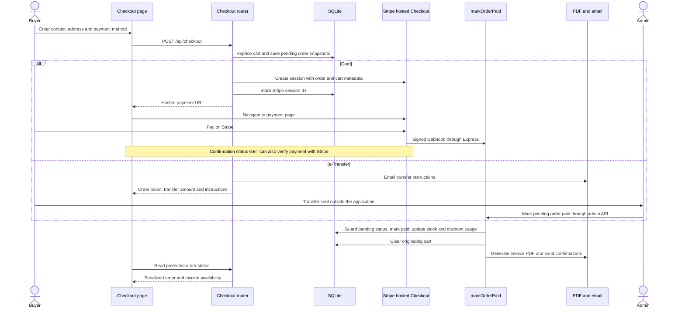

`markOrderPaid` is the common settlement function for card webhooks, confirmation-page reconciliation, development simulation, and admin confirmation of e-Transfers. Its normal repeat guard is `status !== 'pending'`. The payment status update and inventory writes precede asynchronous PDF/email work, but the whole operation is not enclosed in a database transaction or durable job.

Card checkout is refused before order creation when Stripe is disabled, except for the explicit development simulation setting. e-Transfer creates a pending order when `ETRANSFER_EMAIL` is configured. It does not call an Interac API, reserve stock, create an invoice, or claim payment has arrived.

### Order access and status

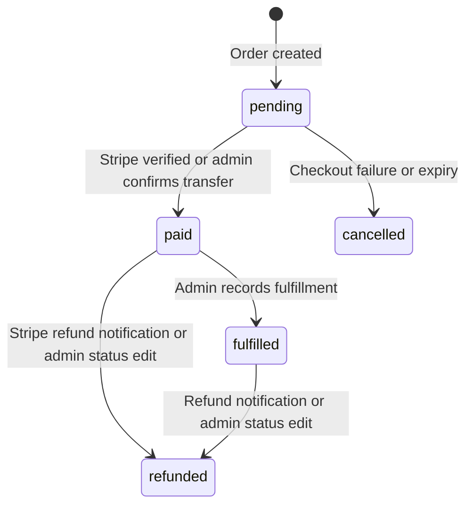

This diagram describes the usual business path. The admin handler accepts all allowed status values without enforcing this transition graph; returning an order to pending can allow settlement effects to run again.

`canAccessOrder` allows the account owner, an admin, a matching guest access token, or a legacy guest order's matching Stripe session ID. Details, confirmation status, and invoice download share that rule. Account order history requires login and lists orders associated with that account; matching email alone does not claim a guest order.

The confirmation page polls every 1.5 seconds, up to 10 attempts while pending. If a pending order has a Stripe session, the status endpoint can query Stripe and settle it when payment is confirmed. PDF downloads are unavailable for pending/cancelled orders and can regenerate a missing file from stored snapshots.

Sources: [cart pricing](server/lib/cart.js), [shipping](server/lib/shipping.js), [checkout routes](server/routes/checkout.js), [order services](server/lib/orders.js), [order downloads](server/routes/orders.js), [invoice rendering](server/lib/invoice.js).

## Donation information flow

Donations are a separate domain from store orders. They have no cart, shipping, inventory, order lines, or store invoice. A new donation charges the selected amount exactly: current code sets `fee_cents` to zero while retaining the column for historical records.

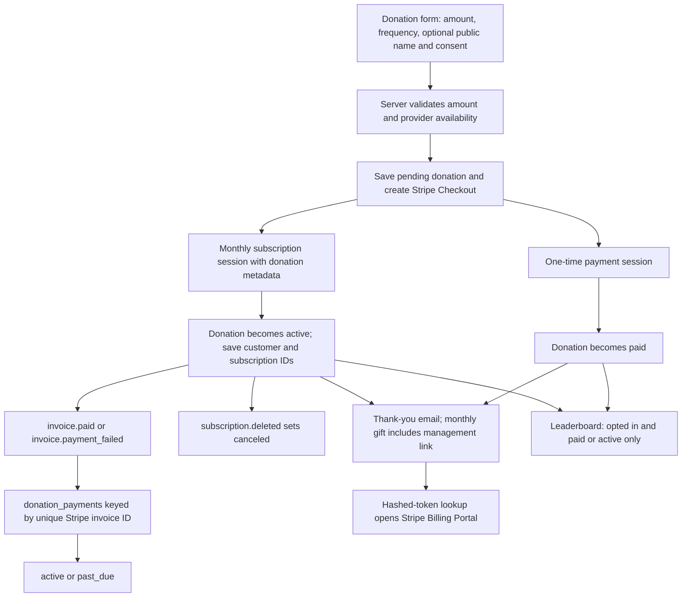

The server refuses new donations before inserting a row when Stripe is unavailable. Monthly giving requires email so the donor can receive a management link. The Stripe recurring product is reused through a configured ID or a cached `app_meta` value.

Checkout completion or the return-page status check settles the initial gift. For subscriptions, invoice webhooks record individual cycles; subscription deletion records cancellation. The webhook accepts multiple Stripe invoice shapes when finding the subscription ID.

Monthly management links use a random bearer token whose hash is stored in SQLite. Rendering a thank-you email issues a fresh token. The link opens Stripe's configured Billing Portal, where the donor can manage the subscription. The public leaderboard exposes only consented display data from paid/active donations, without the donor's email or private message.

Recurring invoice insertion is deduplicated by `stripe_invoice_id`. This is not complete event reconciliation: a failed row already stored for an invoice is not upgraded by a later successful insertion attempt. Replayed checkout events can also repeat donation emails; see the limits below.

Sources: [donation routes](server/routes/donate.js), [donation services](server/lib/donations.js), [webhook dispatcher](server/routes/webhook.js), [notification templates](server/lib/notifications.js).

## Membership information flow

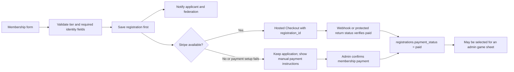

Membership preserves the application even when payment cannot start. Server-owned tiers currently define board/manager/coach at 15,000 cents and player/supporter at 7,500 cents in the configured currency. Board/player applications collect eligibility details; supporter applications have those fields blanked on the server.

Registrations contain sensitive birth, citizenship and family information. Full details and CSV/XLSX exports are admin-only. The public status response requires a matching Stripe session or an admin and returns a reduced payment summary. A registration is independent of a login account or public player profile.

Manual membership instructions use a hardcoded transfer address in the membership router, separate from the shop's `ETRANSFER_EMAIL`. Membership application notifications are sent when the form is saved, before the fee is settled.

Sources: [membership router](server/routes/membership.js), [tier rules and registration serialization](server/lib/registrations.js), [spreadsheet export](server/lib/xlsx.js).

## Teams games and player statistics

### Three different identities

| Record | Purpose |
| --- | --- |
| `players` | Public roster identity: name, profile, team and career history |
| `registrations` | Private membership application and eligibility/payment information |
| `game_sheet_players` | Per-match identity overrides, linked-identity fallbacks and statistics |

A sheet line can reference a player, a registration, both, or neither. Per-match name/number overrides and optional links let the federation record guests. Stored overrides and statistics stay with the sheet; blank identity fields can change with, or disappear after deletion of, their linked profile or registration.

### Event entry and projections

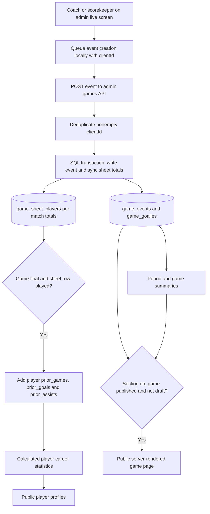

Goals identify a scorer and up to two assists through sheet-line IDs. Penalties reference a penalized sheet line. Goalkeeper records store period minutes, saves and goals against. Unmatched opponent identities can be recorded as name/number snapshots.

For event-mode games, event/goalkeeper mutations and `syncSheetTotals` run in one SQL transaction. Sheet goals, assists, penalty minutes and goalkeeper totals become projections of the detailed records. Adding this detail sets a persistent `events_mode` flag, so deleting the last event does not revert the match to manual totals. Period shots are derived from the opposite side's goalkeeper data.

**The official headline score remains separately editable.** The live screen can copy counted event goals into it; entering an event does not automatically finalize the match or its official result.

The live screen queues **event creation only** in localStorage. It retries retained network failures every 15 seconds and when connectivity/visibility returns. `clientId` plus a partial unique index prevents duplicate creation after retries. Edits/deletes make direct requests. There is no service worker, so the screen must have loaded before a connection loss; the rink clock is entered manually.

### Finalization and publication are independent

| Control | Effect |
| --- | --- |
| `games.status = 'final'` | Played sheet rows become eligible for career statistics |
| `game_sheet_players.played = 1` | This person dressed for the match and accrues the game |
| `games.published = 1` | Allows public display when the other visibility conditions pass |
| `app_meta['section.games'] = '1'` | Enables the public game section and its navigation link |
| Team/player `active` | Controls public team/player profile availability |

Career totals are calculated on read from final, played sheet rows plus the player's `prior_*` counters. There is no separate stored career-total table. An unpublished final sheet still contributes to career totals. Public game links additionally require the section and publication checks. A `statsForTeam` helper exists, but the current team-page renderer does not call it or display a leaders table.

Public game pages are HTML snapshots per request. There is no public score polling, WebSocket, or server-sent event stream; “Live entry” names the admin recording workflow.

Sources: [game admin API](server/routes/admin-games.js), [event projections](server/lib/game-events.js), [game model](server/lib/games.js), [statistics](server/lib/stats.js), [live browser queue](assets/admin/live.js), [public game routes](server/routes/games.js).

## Page content and publishing

### Source HTML and editable copy

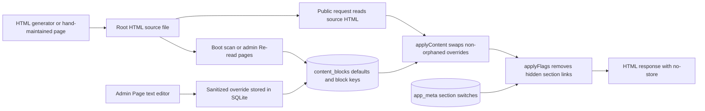

The content editor scans `h1` through `h4`, `p`, and `li` blocks. Keys combine page, tag and occurrence, such as `index.html#h11`. Each record retains source text and an optional override; reset removes the override. Changed page structures can shift keys, and edited blocks that disappear are marked orphaned.

Admin text edits stay in SQLite rather than being written into generated HTML. Source rebuilds therefore preserve the overrides. The server caches overrides and section switches in memory and invalidates the relevant cache on admin writes. Admin pages are excluded from text scanning.

Nested news/team/player/game pages read an existing page as a shell, apply its copy/settings transforms, and replace the main content with database-backed HTML. [server/lib/page.js](server/lib/page.js) centralizes titles, descriptions, social metadata and root-relative link rewriting. Their main article/profile/match content is edited through the corresponding domain admin screen.

| Public content | Read source | Write source |
| --- | --- | --- |
| Informational page text | HTML defaults plus `content_blocks` | Page text admin or source HTML/generator |
| News list and articles | Active `news_posts` | News admin |
| Team/player profiles | Active `teams` and `players`; player career statistics | Teams admin and game sheets |
| Partner list | Active `sponsors` | Sponsors admin |
| Event schedule | Active `programs`, optional team | Schedule/programs admin |
| Match pages | Published non-draft `games`, sheet/events/goalies | Game sheets/live admin plus section switch |

Sources: [content overrides](server/lib/content.js), [visibility settings](server/lib/settings.js), [page shell rendering](server/lib/page.js), [public HTML handling](server/app.js).

## Chat contact email and uploads

### Chat and contact

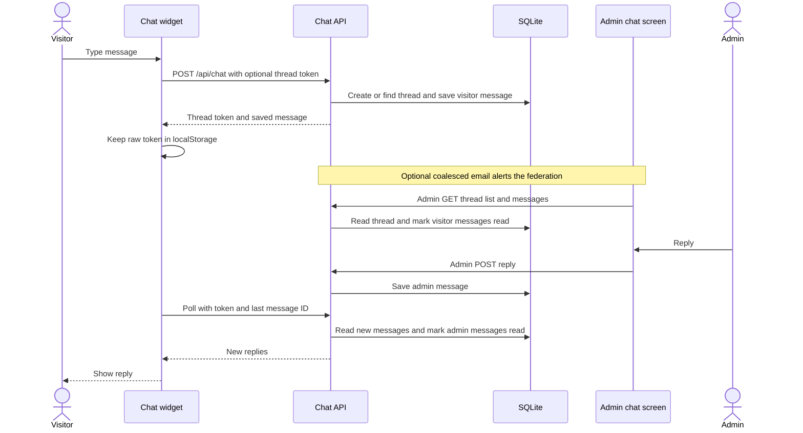

Visitor chat polls every six seconds while open and visible; admin chat polls every eight seconds while visible. A thread is token-owned and has open/closed/blocked state. It has no FK to a user or session. Messages store a visitor/admin sender label rather than an individual staff-author FK.

The contact form follows a simpler path: `POST /api/contact → contact_messages → admin inbox`, with a best-effort email alert. Contact messages and chat conversations are separate tables and screens.

### Email and PDFs

Domain functions call notification templates, which call `sendMail` using Nodemailer. With SMTP configured, messages are sent and logged as `sent` or `failed`. Without SMTP, a JSON transport is used, the console reports the message, and `email_log` records `logged`; no external delivery occurs.

Notifications cover paid orders, transfer instructions, password resets, contact submissions, donations, membership applications and chat alerts. Paid orders generate a PDF through PDFKit and attach the invoice to their confirmation messages. `email_log` stores metadata/error state, not complete message bodies or a retry queue. Mail failures do not reverse payment state.

### Image uploads

1. Admin selects an image; browser sends raw bytes as `application/octet-stream` to `/api/admin/uploads`.
2. The route enforces admin access, CSRF and its own request-body limit; the image helper caps file size at 4 MiB.
3. Magic bytes identify JPEG, PNG or WebP; SVG/document uploads are excluded.
4. A generated filename is written under `assets/uploads` and its public URL is returned.
5. The domain form saves that URL in its product/news/team/player/sponsor record.

Files and database references are separate persistence steps. Invoice PDFs are delivered through authorized order routes; uploaded images are public assets.

Sources: [chat routes](server/routes/chat.js), [chat storage](server/lib/chat.js), [mail transport](server/lib/mail.js), [notifications](server/lib/notifications.js), [upload validation](server/lib/uploads.js), [upload route](server/routes/admin.js).

## Pages and API map

### Public pages

All root public pages load the shared API, app and chat scripts. The controllers below add domain behavior.

| Page or route | Controller or renderer | Main information flow |
| --- | --- | --- |
| `/`, `index.html` | `hero.js`, `marquee.js`, `contact.js` | Federation content, shared account/cart state, contact submission |
| `about.html` | Shared scripts and `hero.js` | Source content plus copy overrides |
| `contact.html` | `contact.js` | `POST /api/contact` |
| `shop.html` | `shop.js` + store core | Categories/products API, filtering/search |
| `product.html?slug=...` | `product.js` + store core | Product API, add to server cart |
| `cart.html` | `cart.js` + store core | Cart read/update/delete and discount validation |
| `checkout.html` | `checkout.js` + store core | Countries, destination summary, order creation and payment redirect |
| `order-confirmation.html` | `confirmation.js` | Protected status polling and PDF download |
| Login/register/forgot/reset pages | `account.js` | Authentication and password reset API |
| `account.html` | `account.js` | Account orders, profile, password and logout |
| `donation.html` | `donation.js` + store core | Gift configuration, leaderboard, Checkout and return status |
| `membership.html` | `membership.js` | Tier configuration, application, payment and return status |
| `news.html` | `news.js` | Public news list API |
| `/news/:slug` | Server news renderer | Active article in `news.html` shell |
| `teams.html`, `/teams` | `teams.js` | Public team list API |
| `/teams/:slug` | Server team renderer | Active team profile, staff/honours, gallery and players |
| `/players/:slug` | Server player renderer | Active player/parent team, calculated career statistics |
| `/games`, `/games/:slug` | Server game renderer | Section visibility and per-match publication filters |
| `events.html` | `schedule.js` | Public programmes/schedule API |
| `sponsors.html` | `sponsors.js` | Public partners API |
| Privacy/cookies/refund policy pages | Shared scripts | Source text plus copy overrides |

### Public and account API families

Paths below have the `/api` prefix. Normal mutations require a valid CSRF token even when login is unnecessary.

| Domain | Methods and routes | Access |
| --- | --- | --- |
| Session | `GET /session`, `/csrf` | Public; CSRF issuance can create guest state |
| Auth | `POST /auth/register`, `/auth/login`, `/auth/logout`, `/auth/forgot`, `/auth/reset` | Public/session; selected rate limits |
| Profile | `PATCH /auth/profile`; `POST /auth/password` | Authenticated account |
| Contact | `POST /contact` | Public, rate limited |
| Catalogue | `GET /categories`, `/products`, `/products/:slug`, `/placeholder/:slug.svg` | Public |
| Cart | `GET /cart`; `POST /cart/items`, `/cart/discount`; `PATCH /cart/items/:id`; `DELETE /cart`, `/cart/items/:id` | Current account or guest session cart |
| Checkout | `POST /checkout`; `GET /checkout/summary`, `/checkout/countries` | Current cart |
| Order status | `GET /checkout/status/:orderId` | Owner/admin/order token or legacy guest Stripe session |
| Orders | `GET /orders`; `GET /orders/:id`, `/orders/:id/invoice` | History requires account; individual read uses shared order-access rule |
| Donations | `GET /donate/config`, `/donate/leaderboard`; `POST /donate` | Public; validated input and Stripe availability |
| Donation status/manage | `GET /donate/status/:id`, `/donate/manage/:token` | Matching Stripe session/admin for status; management bearer token for portal |
| Membership | `GET /membership/config`; `POST /membership`; `GET /membership/status/:id` | Public submission; matching Stripe session/admin for status |
| Public content | `GET /news`, `/roster`, `/teams`, `/teams/:slug`, `/sponsors`, `/programs` | Public filtered views |
| Chat | `GET /chat/config`; `GET /chat`; `POST /chat` | Thread bearer token; public message limit |
| Stripe webhook | `POST /stripe/webhook` | Verified Stripe signature, raw JSON body; outside CSRF |
| Development settlement | `POST /checkout/dev-complete/:orderId` | Only nonproduction with `ALLOW_DEV_CHECKOUT=true`; ordinary CSRF still applies |

### Admin screens and APIs

All admin APIs have the `/api/admin` prefix; all screens have the `/admin/` prefix. Each screen has a matching `assets/admin/<name>.js` controller, except `index.html` uses `dashboard.js`. Both HTML and API requests require an admin role.

| Screen | API resources and operations |
| --- | --- |
| `index.html` | `GET /overview`, `/stats` |
| `products.html` | Product/variant CRUD and category selection; category API additionally supports list/create/delete |
| `orders.html` | List/read orders; `PATCH /orders/:id` for settlement/status |
| `customers.html` | List/read customers and change roles; customer creation is an additional API capability |
| `invoices.html` | List invoices; `POST /invoices/:orderId/regenerate`; authorized order PDF download |
| `discounts.html` | List/create/edit/delete discount codes |
| `donations.html` | List gifts; `PATCH /donations/:id/visibility` |
| `news.html` | List/create/edit/delete articles; image upload |
| `chat.html` | `GET /chat`, `/chat/:id`; `POST /chat/:id` reply; `PATCH /chat/:id` status |
| `messages.html` | List/delete contact messages |
| `sponsors.html` | List/create/edit/delete sponsors; image upload |
| `programs.html` | List/create/edit/delete schedule entries |
| `registrations.html` | List/search applications; CSV/XLSX exports; `PATCH /registrations/:id/paid` |
| `teams.html` | Team CRUD; `GET /teams/:id/players`; player create/edit/delete; image upload |
| `games.html` | Game CRUD; sheet fill/line CRUD; event/goalie CRUD; publish/unpublish; `POST /games/section` |
| `live.html` | `GET /live/games`, `/games/:id/live`; event create/edit/delete; game/header updates |
| `roster.html` | List/create/edit/delete legacy roster records |
| `shipping.html` | Zone CRUD; `PATCH /shipping/:id/default` |
| `content.html` | List blocks; `PATCH /content/:key`; `POST /content/:key/reset`, `/content/resync` |

Collection CRUD generally means `GET/POST /resource` plus `PATCH/DELETE /resource/:id`. Game children use `/games/:id/sheet`, `/sheet/fill`, `/sheet/:lineId`, `/events/:eventId`, and `/goalies/:goalieId`; publish/unpublish are POST actions. Upload creation uses `POST /uploads` with binary bytes.

Router registration is in [server/app.js](server/app.js). Detailed behavior lives in [admin.js](server/routes/admin.js), [admin-teams.js](server/routes/admin-teams.js), [admin-games.js](server/routes/admin-games.js), [sponsors.js](server/routes/sponsors.js), and [programs.js](server/routes/programs.js).

## Deployment and persistence

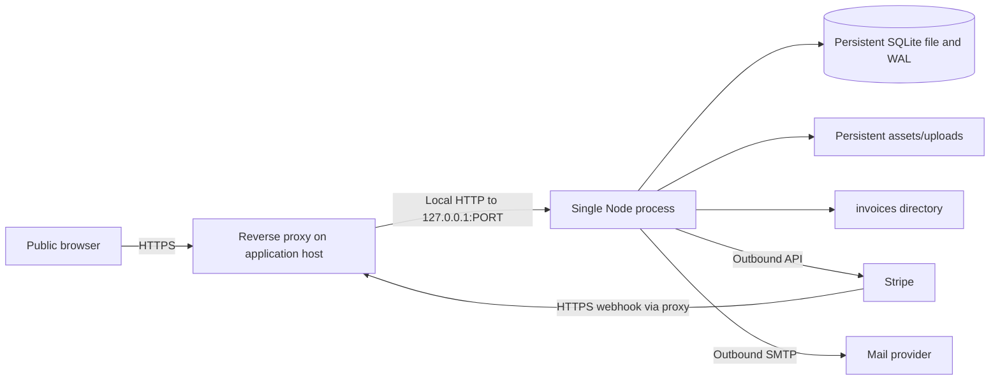

The server currently binds to `127.0.0.1`. This diagram shows a compatible deployment arrangement; no reverse-proxy or hosting configuration is included in this repository. A different hosting arrangement needs an appropriate listener/bind change.

SQLite uses WAL and synchronous queries on the application thread. In-memory rate limits, content caches and settings caches assume one process. A multi-process deployment would need coordinated rate limits/cache invalidation and a deliberate shared-storage strategy.

| Configuration area | Relevant settings and effect |
| --- | --- |
| Listener and external URLs | `PORT`, `APP_URL`; public URL is used for payment return links, emails and share metadata |
| Runtime mode | `NODE_ENV`; production enables secure cookie/HSTS behavior and disables checkout simulation |
| Database | `DB_PATH`; defaults to `data/store.db` |
| Sessions | `SESSION_SECRET` is required by production configuration, although current session middleware does not use it for signing |
| Admin creation | `npm run create-admin -- --email ...`; `ADMIN_EMAIL` can assign admin role during registration |
| Card payments | `STRIPE_SECRET_KEY`, `STRIPE_WEBHOOK_SECRET`; publishable key is optional for the hosted redirect flow |
| Manual shop payments | `ETRANSFER_EMAIL`, `ETRANSFER_NAME` |
| Pricing | `CURRENCY`, `TAX_RATE`, shipping fallback/origin settings; configured zones take precedence |
| Donations | Min/max amount settings and optional `STRIPE_DONATION_PRODUCT_ID` |
| Email/chat | SMTP settings, `MAIL_FROM`, `MAIL_ADMIN`, `CHAT_NOTIFY_EMAIL`, `CHAT_NOTIFY_COALESCE_MINUTES` |
| Proxy trust | `TRUST_PROXY`; enable only for the actual proxy arrangement |
| Local simulation | `ALLOW_DEV_CHECKOUT=true`, with production explicitly off |

Stripe must deliver the event types handled in [webhook.js](server/routes/webhook.js): checkout completion/expiry/async success/failure, `invoice.paid`, `invoice.payment_failed`, `customer.subscription.deleted`, and `charge.refunded`. The Billing Portal must also be configured in Stripe for donation management links to work.

The current production configuration **requires a Stripe secret key at startup**, even though development supports provider-free browsing and manual e-Transfer orders. This differs from the broader no-Stripe description in the README.

Preserve the SQLite database, uploaded images, and environment configuration across deployments. Invoice metadata and order snapshots are in SQLite and can regenerate PDFs. A consistent SQLite backup must account for WAL; copying only the main database file during writes is insufficient. Database and invoice directories are gitignored; uploaded image files are not currently covered by that ignore rule.

Only assets and allowed public HTML are served statically. Server code, the database, environment files, documentation under `docs`, and invoice storage are not directly exposed through the public file routes.

## Current implementation limits

These details define the behavior of the current architecture and affect changes to payments, live scoring, and deployment.

| Area | Current behavior and consequence |
| --- | --- |
| Order settlement | Pending-status guard suppresses ordinary repeated calls, but settlement has no encompassing SQL transaction or durable outbox. A crash can leave paid state with incomplete side effects. |
| Inventory | Pending orders do not reserve stock. Multiple pending orders can exceed available stock; settlement clamps stock to zero. |
| Admin order transitions | Allowed statuses can be selected without a strict transition policy. Resetting to pending can allow repeated stock/redemption effects. |
| Refunds | Local refunded status does not issue a Stripe refund or restore inventory. Refund webhook handling only changes order status; partial refunds are not separately represented. |
| Tax | Local totals include configured tax, but Stripe checkout currently builds merchandise/shipping/discount lines without passing that tax amount. Nonzero-tax charges can disagree with recorded totals. |
| Donation webhook replay | Initial-gift emails can repeat on checkout event replay and issue a new management token. Invoice-ID uniqueness prevents duplicate cycle inserts but does not reconcile failed-to-paid updates for an existing invoice. |
| Donation event ordering | Subscription lookup depends on a saved subscription ID. An earlier invoice event can be ignored; no reconciliation worker queues it for later. |
| Notifications | Email attempts are logged; there is no durable retry worker. SMTP failures leave payment state intact. |
| Live entry | Only event creation is queued for network retry; edits/deletes and offline cold starts need connectivity. Public match pages update on a new request. |
| Game publishing | Final status, public publishing, section visibility, official score, and warning review are separate controls. Publication does not establish score completeness. |
| Legacy roster | One-time profile migration provides no ongoing synchronization between legacy roster screens and new public player profiles. |
| Session configuration | `SESSION_SECRET` is required in production, but current sessions use opaque hashed bearer tokens without cookie signing; changing that setting does not itself revoke stored sessions. |
| Multi-process operation | Rate limits and copy/settings caches are per process. No shared coordination layer is present. |
| Data lifecycle | Session expiry has scheduled cleanup; there is no general retention, backup, or job-processing service in this repository. |

Older README descriptions of donation fee top-ups, signed session cookies, shared `store.js`/`admin.js` files, and page counts do not describe the current implementation. The referenced code and SQL snapshot provide the current structure.

## Where to make changes

| Intended change | Main files or workflow |
| --- | --- |
| Generated public navigation, store or account forms | [scripts/build-store-pages.mjs](scripts/build-store-pages.mjs), then `npm run build` |
| Admin navigation or HTML forms | [scripts/build-admin-pages.mjs](scripts/build-admin-pages.mjs), then build |
| Original informational-page structure | Corresponding root HTML file |
| Public copy without code changes | Admin Page text; [server/lib/content.js](server/lib/content.js) handles storage/rendering |
| Browser request/session behavior | [assets/api.js](assets/api.js) |
| Page-specific browser behavior | Matching controller in `assets` or `assets/admin` |
| Shared visual styles | [assets/styles.css](assets/styles.css), [assets/store.css](assets/store.css), [assets/admin.css](assets/admin.css) |
| Catalogue/cart/discount/shipping behavior | Domain routers plus [cart.js](server/lib/cart.js), [money.js](server/lib/money.js), [shipping.js](server/lib/shipping.js) |
| Payment creation and settlement | [checkout.js](server/routes/checkout.js), [orders.js](server/lib/orders.js), [webhook.js](server/routes/webhook.js) |
| Donations and recurring billing | [donate.js](server/routes/donate.js), [donations.js](server/lib/donations.js), webhook dispatcher |
| Membership fields and fees | [membership.js](server/routes/membership.js), [registrations.js](server/lib/registrations.js) |
| Game/event validation and totals | [admin-games.js](server/routes/admin-games.js), [game-events.js](server/lib/game-events.js), [stats.js](server/lib/stats.js) |
| Server-rendered profiles/articles/matches | `server/lib/teams.js`, `news.js`, `games-page.js`, and shared `page.js` |
| Transactional email/PDF format | [notifications.js](server/lib/notifications.js), [mail.js](server/lib/mail.js), [invoice.js](server/lib/invoice.js) |
| Schema evolution | [server/db.js](server/db.js); game-slug index initialization also uses [server/lib/games.js](server/lib/games.js) |

Available validation commands are `npm run smoke` against a running development instance, `npm run check-site` for page/reference checks, and `npm run contrast` for design-token contrast. Smoke checks exercise data-writing workflows and should run against an isolated test database. A documentation-only change does not require rebuilding generated pages or running payment flows.

The SQL snapshot was generated by applying schema initialization and game-slug index initialization to an isolated in-memory database. It contains structure only, without stored user records or seed rows. When schema code changes, regenerate the snapshot and update the diagrams and table inventory together.
